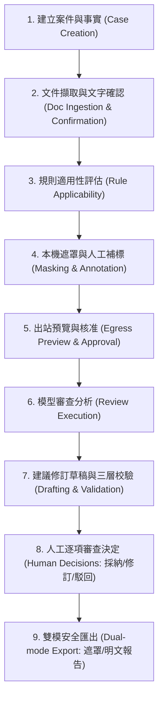

# 中央研究院資訊採購合約資安審查助手 (Academia Sinica Security Procurement Review Assistant)

本系統專為中央研究院資訊處與法務單位設計，協助公務採購合約進行全流程安全審查。系統支援四類採購合約（軟體維護、委外開發、雲端服務、混合型採購），並在保護敏感個資與機敏內部資料的前提下，導入合規的雲端或離線大語言模型進行逐條比對與修訂條款草稿產製。

---

## 1. 核心安全架構與設計原則

本助手嚴格遵循《資通安全管理法》、政府採購法規及中研院內部資通安全規範，具備以下強制安全防禦保證：

1. **嚴格本機邊界與存取控制**：
   - 伺服器僅監聽本機 Loopback 介面（`127.0.0.1`），嚴禁外部網路直接連線。
   - 系統採用單次使用（One-time）的 Bootstrap Token，僅透過 URL Fragment 於首次本機瀏覽器開啟時交換 Session，不留存於存取日誌中。
   - 所有資料目錄權限嚴格設為 `0700`，產物匯出檔案權限設為 `0600`。

2. **端對端 AES-256-GCM 機密儲存庫 (Vault)**：
   - 原始合約、結構快照、遮罩映射表與暫存回覆，均以 256 位元主資料金鑰與獨立隨機 Nonce 進行加密落盤。
   - 金鑰儲存於本機作業系統安全金鑰庫（如 macOS Keychain），絕不以明文存於磁碟。

3. **零未核准出站保證 (Zero Unapproved Egress)**：
   - 出站 Payload 嚴格限制僅能透過 HTTPS 傳送至白名單核准之端點。
   - 出站內容必須經過本機去識別化（PII Masking）及人工預覽核准，出站請求嚴格綁定雜湊與核准簽名；任何 1 byte 變更或 Run 過期立即中斷連線。

4. **零未驗證引用與三層條款校驗**：
   - 審查判定嚴格依據已全文查核的法規來源（`verified_full_text`），嚴禁虛構或捏造法條引用。
   - 建議修訂條款強制通過「結構、來源、實質」三層檢驗，防止偷改天數、主體交換或例外條款遭非預期刪除。實質語意校驗強制保留給審查人員最終裁量。

5. **零總體合規分數約束 (Zero Overall Score Constraint)**：
   - 系統依法律責任原則，**嚴禁產出「整份 100% 合規」等總體分數結論**，僅提供逐項條款合規分析與人工裁決記錄。

6. **重啟安全恢復與防靜默重置**：
   - 伺服器重啟或中斷時，自動將前次執行中之 Run 標記為 `interrupted`，維持審查追蹤完整性。
   - 災難復原時若金鑰不符立即拒絕放行，絕不靜默重置目標目錄。

---

## 2. 審查全流程（九大階段）



1. **建立案件與事實**：登錄採購標的、預算、機敏等級、適用採購家族（勞務服務、開發、雲端、套裝）。
2. **文件擷取與文字確認**：解析 DOCX / 文字型 PDF，建立區塊與條款定位，由承辦人進行初次文字確認。
3. **規則適用性評估**：利用宣告式三值邏輯引擎，針對案件事實精確篩選適用之資安要求，未知欄位標記待確認。
4. **本機遮罩與人工補標**：自動偵測機構、人名、聯絡方式等機敏資訊，支援承辦人手動補標遮罩實體，產製獨立命名空間 Token。
5. **出站預覽與核准**：檢視實際即將送出之 Payload，核對雜湊並具名簽署出站核准。
6. **模型審查分析**：透過核准之供應商適配器（合成模式 MockProvider / 真實模式 CloudAdapter）執行條款合規對照。
7. **建議修訂草稿與三層校驗**：產製建議修正條文草稿，自動執行防竄改與時限保護校驗。
8. **人工逐項審查決定**：法務或承辦人逐項執行「採納 (ADOPT)」、「修訂 (MODIFY)」或「駁回 (REJECT)」，記錄完整軌跡。
9. **雙模安全匯出**：支援遮罩稿（Masked）與經授權確認之明文稿（Plaintext），以權限 `0600` 匯出 Markdown 與 JSON 報告。

---

## 3. 快速上手 (Quick Start)

### 3.1 環境需求
- Python `>= 3.13`
- 套件與依賴管理器：[uv](https://docs.astral.sh/uv/)

### 3.2 系統自我診斷 (`doctor`)
在啟動服務前，請使用 `doctor` 子命令檢查環境、依賴套件、金鑰儲存庫及目錄權限：
```bash
uv run procurement-review doctor --mode synthetic --data-dir ./data
```

### 3.3 啟動 Web 審查服務 (`serve`)
```bash
uv run procurement-review serve --mode synthetic --data-dir ./data --port 8765
```
啟動後終端機將顯示包含單次 Bootstrap Token 之本機網址：
```
👉  http://127.0.0.1:8765/#token=<ONE_TIME_BOOTSTRAP_TOKEN>
```
在受信任的瀏覽器開啟該連結即可完成會話初始化。

### 3.4 執行多維度評測 (`evaluate`)
以合成資料集驗證四類採購規則包與發布檢核門：
```bash
uv run procurement-review evaluate \
  --manifest evaluations/synthetic-manifest.json \
  --output ./evaluation_report.json \
  --policy evaluations/acceptance-policy.example.json
```

### 3.5 加密備份與受控清除 (`backup`, `restore`, `purge`)
```bash
# 產製加密備份
uv run procurement-review backup --data-dir ./data --target ./backup.bundle --recovery-key "YOUR_RECOVERY_KEY"

# 還原加密備份至新目錄
uv run procurement-review restore --backup ./backup.bundle --target ./restored_data --recovery-key "YOUR_RECOVERY_KEY"

# 受控清除預覽 (Dry-run)
uv run procurement-review purge --case-id "<UUID>" --data-dir ./data --dry-run

# 綁定確認雜湊執行受控清除
uv run procurement-review purge --case-id "<UUID>" --data-dir ./data --confirmation-hash "<HASH>"
```

---

## 4. 四類採購情境支援說明

| 採購情境類別 | 範疇與代表情境 | 關鍵資安底線與邊界約束 |
|---|---|---|
| **軟體維護 (software_maintenance)** | 既有核心系統、套裝軟體與資料庫日常維護勞務 | 維護到場原則、遠端連線強制 2FA 與側錄、弱點修補時限、緊急通報期限。 |
| **委外開發 (custom_software)** | 機關客製化業務系統、差勤系統委外建置 | 原始碼交付、SSDLC 安全開發規範、弱點掃描滲透報告、智財權與授權邊界。 |
| **雲端服務 (cloud_service)** | 公有雲 IaaS/PaaS 資源訂閱、SaaS 雲端工具 | 機敏資料我國境內儲存、禁止線上 TOS 單方變更、第三方驗證認證與退場資料移轉。 |
| **混合型採購 (mixed)** | 套裝軟體＋客製模組、地端機房＋混合雲代管 | 跨類別責任界定、非必要套裝原始碼除外、提示注入文字防禦。 |

---

## 5. 系統限制與已知邊界 (Limitations)

1. **套裝軟體原始碼限制**：現成商用套裝軟體（COTS）廠商受智慧財產權保護，系統不建議無條件要求其核心源碼，應約定責任上限與託管條款。
2. **遠端維護政策約束**：本系統預設採購合約以本機實體到場為原則；遠端存取必須於合約事實中明確標記，並要求安全防護配套。
3. **資料集隔離**：本版本庫僅收錄公開合成評測集（Synthetic Development Split）；真實機敏合約與黃金標註僅存放於隔離目錄（Real Holdout Split），嚴禁提交至 Git。
4. **硬體安全抹除**：受控清除依政策於作業系統層級刪除檔案與標記墓碑紀錄，不宣稱能對現代 SSD/NVMe 控制晶片進行實體區塊覆寫抹除。

---

## 6. 運維與驗收文檔索引

- 運維與災難復原手冊：[docs/operations.md](file:///Users/kih/Desktop/%E6%B3%95%E5%8B%99agent/docs/operations.md)
- 驗收標準與評測規範：[docs/acceptance.md](file:///Users/kih/Desktop/%E6%B3%95%E5%8B%99agent/docs/acceptance.md)
- 規則編寫與法規維護指南：[docs/rule-authoring.md](file:///Users/kih/Desktop/%E6%B3%95%E5%8B%99agent/docs/rule-authoring.md)
- 雲端供應商上線指南：[docs/provider-onboarding.md](file:///Users/kih/Desktop/%E6%B3%95%E5%8B%99agent/docs/provider-onboarding.md)
