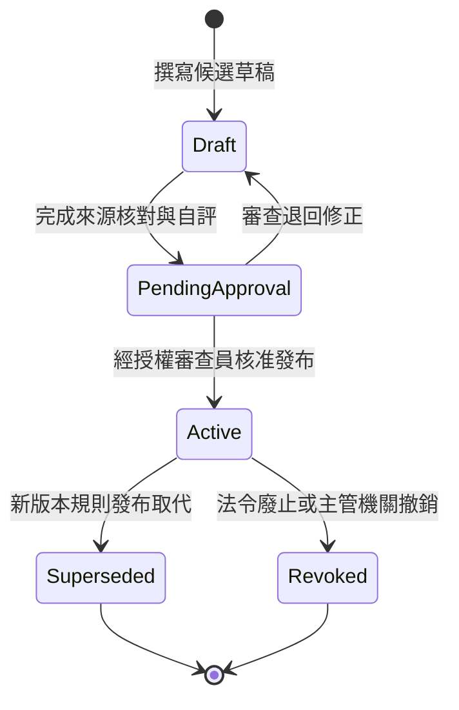

# 規則編寫與法規維護指南（Rule Authoring Guide）

> **適用對象**：資安承辦人、法務審查員、規則庫維護工程師  
> **系統**：中央研究院資訊採購合約資安審查助手  
> **文件版本**：v1.0

---

## 1. 規則生命週期與狀態機（Rule Lifecycle）

本系統為確保公務採購審查之法定公信力與可稽核性，對所有資安規則與要求實施嚴格的狀態機治理：



### 狀態說明與約束：
1. **`draft`（草稿）**：
   - 位於 `rules/drafts/*.json` 之候選規則，允許隨程式碼版本控制進行編輯、檢視與比對。
   - **禁止事項**：草稿規則嚴禁直接納入正式審查判定引擎；在測試環境中僅能使用隔離之 `synthetic` 測試資料集。
2. **`pending_approval`（待核准）**：
   - 已完成來源核對、條款錨定與自評，準備提送資安法務會議或審查委員會簽核之狀態。
3. **`active`（已生效）**：
   - 經具名且經認證之核准者（如資安長、法務主管）執行 `release_rules` 發布之規則。
   - **發布硬性檢查**：所有引用之法規來源必須已完成全文查核（`verified_at` 與 `verified_by` 存在且非空，且 `retrieval_status == "verified_full_text"`），否則系統拋出 `UNVERIFIED_SOURCE` 阻擋發布。
4. **`superseded`（已被取代）**：
   - 當新版規則發布且其 `supersedes` 欄位包含舊版規則 ID 時，舊版規則自動轉為 superseded，在篩選時判定為 `not_applicable`。
5. **`revoked`（已撤銷）**：
   - 經呼叫 `revoke_rule` 撤銷之規則，系統將自動連動資料庫，使所有引用該規則之歷史 `ReviewRun` 標記為 `stale = True`，強制提醒承辦人重審。

---

## 2. 規則與要求契約規格（Rule & Requirement Contract）

### 2.1 規則模型（Rule）
規則定義儲存於 `Rule` 模型，包含政策立場、爭點說理與適用條件：

```python
class Rule(StrictBaseModel):
    rule_id: UUIDStr                     # 唯一不可變 UUID
    version: str                         # 語意化版本（如 "1.0"）
    status: RuleStatus = RuleStatus.DRAFT # 預設必為 draft
    title: str                           # 規則標題
    category: ProcurementFamily          # services / cloud / cots / development
    requirement_text: str                # 具體條文義務文本
    source_refs: list[VersionRef]        # 關聯官方來源 ID、版本與雜湊
    applicability: dict[str, Any]        # 宣告式適用條件表達式
    mandatory: bool = True               # 是否為必要項
    severity: RiskLevel                  # critical / high / medium / low / info
    non_negotiable: bool = False         # 是否為不可退讓之法定底線
    company_position: str | None         # 院方政策立場與談判底線說明
    fallback_positions: list[str]        # 備用讓步立場
    target_sentences: list[str]          # 合約文字特徵詞與關鍵字
    example_clauses: list[str]           # 範例條款摘錄
    conflicts_with: list[str]            # 衝突規則 ID
    supersedes: list[str]                # 取代之舊規則 ID
```

### 2.2 原子要求契約（Requirement）
單一規則會映射為一個或多個原子要求（`Requirement`），供條款路徑與要求路徑實施嚴格審查：

```python
class Requirement(StrictBaseModel):
    requirement_id: UUIDStr              # 要求唯一識別碼
    version: str                         # 版本號
    rule_ref: VersionRef                 # 關聯 Rule 版本參照
    obligation: str                      # 具體可判定的要求內涵
    obligor: str                         # 義務主體：vendor / contractor / agency
    condition: str | None                # 適用條件 JSON 字串
    mandatory: bool = True               # 是否強制
    evidence_requirements: list[str]     # 審查佐證要求
    deterministic_checks: list[dict]     # 確定性檢查條件
    risk_level: RiskLevel                # 風險等級
    required_documents: list[str]        # 必要檢附之證明文件
    protected_constraints: list[str]     # 受保護底線（不可被特約排除之限制）
```

---

## 3. 宣告式條件語法（Declarative Applicability Conditions）

適用性條件透過結構化 JSON 表達，嚴格由系統解析器計算，**禁止使用任何 `eval()`、動態代碼或未定義運算子**。

### 支援運算子清單：
| 運算子 | 語法範例 | 說明 |
|---|---|---|
| `all` | `{"all": [{"eq": ["core_system", true]}, {"eq": ["remote_access", true]}]}` | 所有子條件皆為 True 始為 True |
| `any` | `{"any": [{"eq": ["customization_required", true]}, {"eq": ["source_code_escrow_agreed", true]}]}` | 任一子條件為 True 即為 True |
| `not` | `{"not": {"eq": ["personal_data_involved", false]}}` | 條件邏輯反轉 |
| `eq` | `{"eq": ["security_level", "高"]}` | 事實欄位與期望值比對 |
| `in` | `{"in": ["services", "procurement_families"]}` | 集合包含比對 |
| `gte` | `{"gte": ["budget_amount", 1000000]}` | 數值大於等於比對 |
| `lte` | `{"lte": ["budget_amount", 50000000]}` | 數值小於等於比對 |
| `exists`| `{"exists": "service_scope"}` | 欄位存在且非空 |

### 三值邏輯（Kleene 3-Valued Logic）核心原則：
1. **未知不等於假**：若案件事實欄位為 `None` 或列於 `unknown_fields`，計算結果必須為 `None`（Unknown）。
2. **審查判定**：
   - 條件為 `True` $\rightarrow$ `ApplicabilityState.APPLICABLE`（適用）。
   - 條件為 `False` $\rightarrow$ `ApplicabilityState.NOT_APPLICABLE`（不適用）。
   - 條件為 `None` $\rightarrow$ `ApplicabilityState.UNKNOWN`（待確認，提醒承辦人補件事實）。
3. **程序 vs 實質資安要求**：若採購制度未知（`procurement_system is None`），僅程序型條款判定為 unknown，實質保密與資安要求仍持續 applicable。

---

## 4. 領域審查底線與邊界原則

編寫候選規則時，必須遵守以下公務採購資安與法務邊界原則：

### 4.1 套裝軟體（COTS）邊界原則
- **不得無條件要求核心原始碼**：現成商用軟體廠商擁有專有智慧財產權，除非涉及專案客製開發，或有營運持續疑慮且雙方明訂第三方 Escrow 託管，否則不得無條件強制索取核心源碼。
- **合理責任上限**：廠商智慧財產權防衛義務不得免除，但金錢賠償責任得依標的金額約定合理上限（如合約總額之1至2倍），不得強推無上限無限連帶賠償。

### 4.2 資訊服務勞務邊界原則
- **到場原則與遠端例外**：中研院實施要點明定委外維護以到場為原則，遠端連線必須嚴格列為例外，並強制具備事前核准、雙因子認證、IP限制、加密通道與側錄稽核。
- **資安專項責任**：工程會第16條第17款為法定資安責任，各目要求（弱點修補、事件通報、資安計畫）不得在合約中被整條刪除。

### 4.3 雲端服務邊界原則
- **境內落地原則**：機敏及個人資料雲端處理以境內為原則，跨境傳輸必須事前專案簽准。
- **禁止單方變更**：不得允許雲端供應商以線上 TOS 變更為由，單方實質縮減服務規格、提高費用或降低資安水平。合約條款必須優於線上通用條款。

### 4.4 作業指南與建議性質保留
- 數位發展部或主管機關之「作業指南」或「注意事項」具輔導與建議性質，在規則模型中應標記來源性質為 `guideline_recommendation`。系統在適用性判定中保留建議性質註記，不得偽稱為強行法令義務。

---

## 5. 新增與擴充規則標準作業程序（SOP）

當主管機關更版契約範本或修訂法規時，請依下列步驟擴充規則：

1. **更新來源清單（Manifest）**：
   - 於 `rules/sources/manifest.json` 登記新法規或範本，填入 Source ID、條款定位、發布日期、生效日期與 SHA-256 雜湊。
   - 若尚未取得完整本機受控受檢全文，設定 `retrieval_status: "index_only"`。
2. **編寫草稿規則（Drafts）**：
   - 於 `rules/drafts/{common,services,cloud,cots,development}.json` 新增對應之 `rules` 與 `requirements`。
   - 確保 `status` 設定為 `"draft"`。
   - 設定精確的 `source_refs`、`obligor`、`condition` 與 `company_position`。
3. **執行 TDD 驗證**：
   - 執行 `uv run pytest tests/integration/test_rule_sources.py`。
   - 驗證所有規則與要求結構完整、來源存在且條件符合邊界約束。
4. **人工審查與正式發布（Human Release）**：
   - 由資安查核員逐項核對原檔全文後，將來源狀態更新為 `verified_full_text` 並填寫 `verified_at` 與 `verified_by`。
   - 透過管理介面或受控腳本執行 `release_rules`，規則正式轉為 `active` 並進入生產儲存庫。
